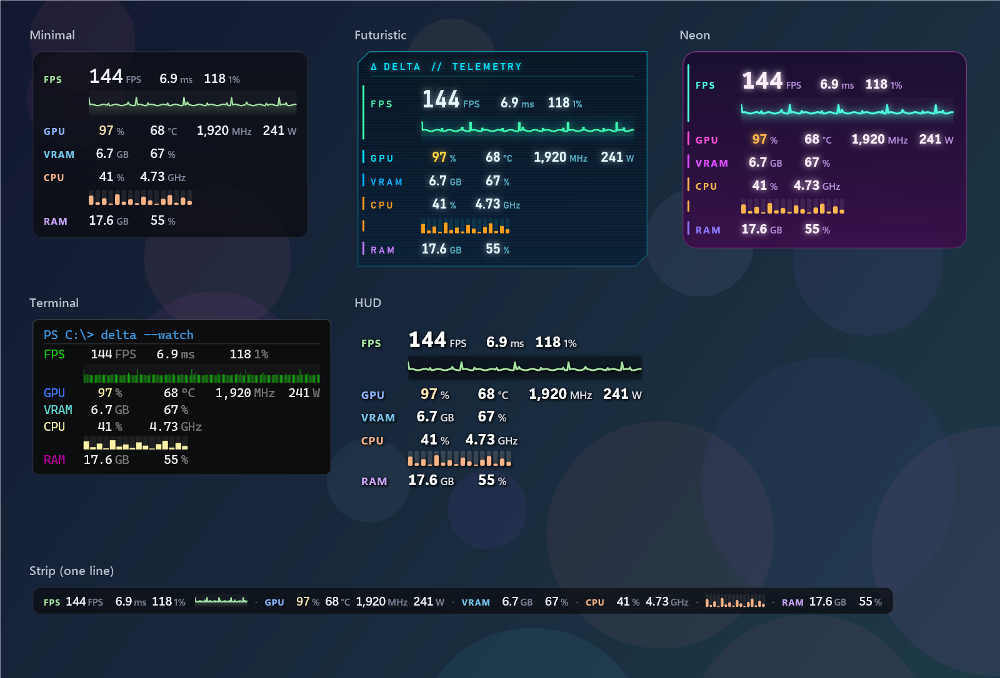
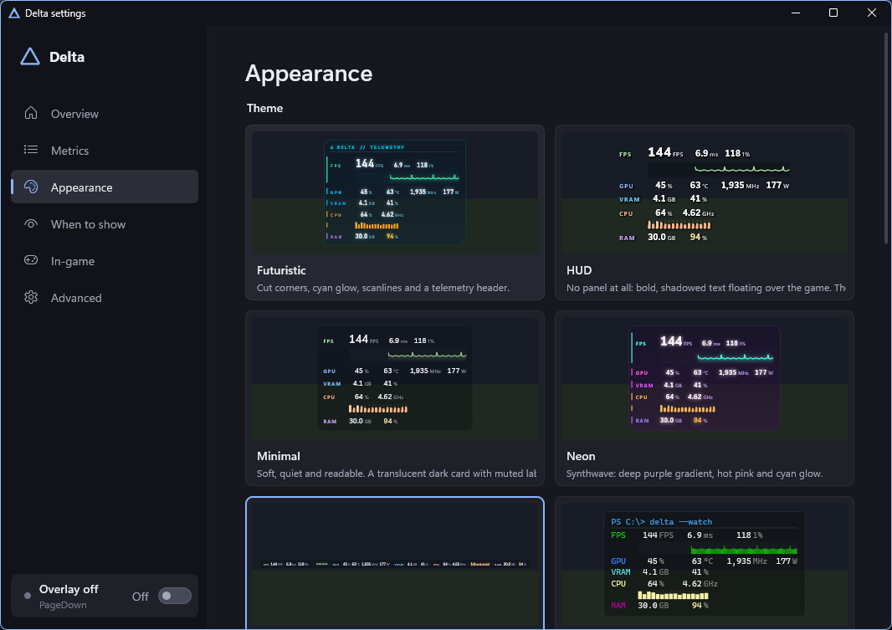
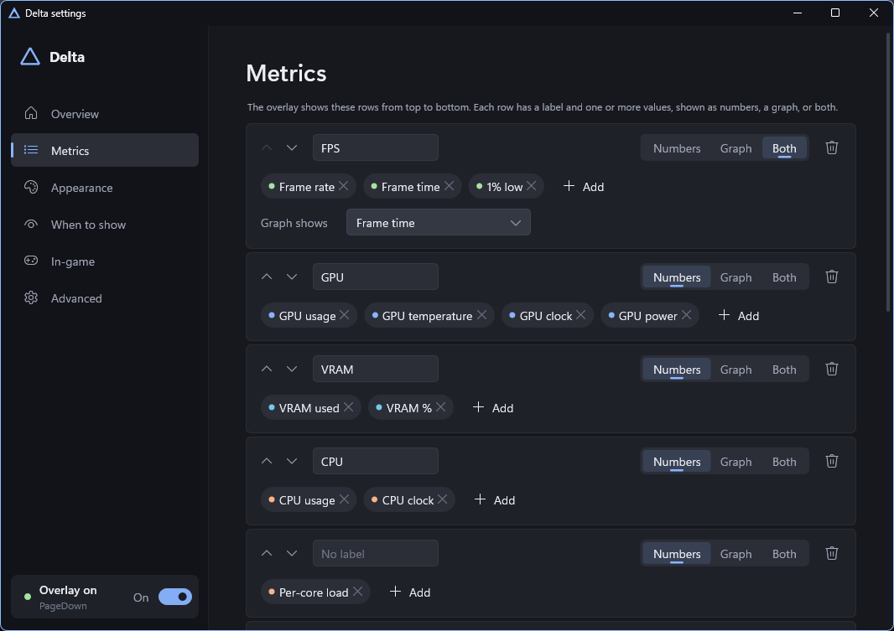

<div align="center">

# Δ Delta

**A light, good-looking performance overlay for Windows games.**
FPS, frame times, GPU, CPU, RAM, disk and network, the way you want them. Nothing else.

[**Download**](https://github.com/Lancito01/delta/releases/latest) · [Themes](#themes) · [Exclusive fullscreen](#exclusive-fullscreen-games) · [Build](#build-from-source)



</div>

## Why Delta

- **Looks the way you want.** Six built-in themes, from a quiet card to a terminal window to neon. Duplicate any of them and make it yours.
- **Shows what you want.** Pick the metrics, their order, and numbers, graphs or both. Per-core CPU bars, a frame time graph, 1% lows.
- **Numbers that sit still.** Every value keeps room for its widest reading, so nothing shifts as digits change.
- **A real settings window.** Native and instant, with live previews of every theme. No config files needed (they're there if you want them).
- **Light.** One ~1 MB exe, no runtime, no web engine. About 0.1% CPU.
- **Stays out of the way.** Click-through, never takes focus, hides from recordings if you like, and lets your other always-on-top apps stay on top.
- **Never loads anything into your games.** Delta reads FPS from Windows' own graphics events. In exclusive-fullscreen games it draws through RivaTuner, which anti-cheat systems generally accept.
- **Works with RivaTuner apps.** HWiNFO, AIDA64, OBS HUD and others that draw through RivaTuner's on-screen display work with Delta, with or without RivaTuner.
- **Updates itself** from GitHub releases, checked against GitHub's checksum.

## Get started

1. Download **[delta.exe](https://github.com/Lancito01/delta/releases/latest)**, put it in its own folder, and run it.
   Windows may warn that the app is unsigned the first time: **More info → Run anyway**.
2. A Δ appears in the tray. **Click it** for settings: every change shows on the overlay right away.
3. For FPS in every game, run Delta **as administrator** (Settings → Overview → *Restart as administrator*).
   Windows only shares the graphics events FPS comes from with admin apps.

Show or hide the overlay with **Ctrl+Shift+F10** (you can change it).

## Settings

<p align="center">
  
  
</p>

| Page | What's there |
|---|---|
| **Overview** | Turn the overlay on or off; status of FPS, your graphics card, RivaTuner apps and exclusive-fullscreen games |
| **Metrics** | Rows top to bottom: a label, metrics picked from a list, numbers / graph / both; colors by value |
| **Appearance** | Theme gallery; rows or one line; position, size; transparency of the whole overlay, the background and the text; spacing |
| **When to show** | Always, in games, or over fullscreen apps; which monitor (main, the game's, the active window's, all); hotkeys; apps to skip, only show over, or keep on top |
| **In-game** | RivaTuner status and setup for exclusive-fullscreen games |
| **Advanced** | Update rates, graph lengths, GPU choice, RivaTuner app support, updates |

Settings live in `%APPDATA%\Delta\config.toml` and can still be edited by hand. For a portable copy,
put a `config.toml` next to `delta.exe`.

### Metrics

| | |
|---|---|
| Frames | frame rate, frame time, 1% low, 0.1% low |
| Graphics card | usage, temperature, core and memory clocks, power, fan, VRAM |
| Processor | usage, temperature, effective clock, per-core load bars, per-core load and clocks |
| Memory | RAM used, total RAM, RAM %, the game's own memory |
| Disk & network | read, write, activity, download, upload |
| Other | the app in front, the time |

## Themes

Pick one in Settings → Appearance. *Duplicate to customize* copies it to your themes folder and
opens it. A theme only needs what it changes:

```toml
name = "Ocean"
extends = "minimal"

[colors]
background = "#0A1A2ACC"
accent = "#4FC3F7"

[graph]
style = "line"   # line | area | bars | step
```

[`themes/minimal.toml`](themes/minimal.toml) lists every option: fonts, colors and per-group
accents, panel shape (rounded, cut or bracket corners), borders, graph style, core bars, glow,
shadow, headers and scanlines. Changes show up as you save.

## Exclusive fullscreen games

No window can appear over a game running in true exclusive fullscreen. Most games are fine (they
run borderless, or Windows makes them so). When one isn't, Delta tells you once, and you can:

- **Switch the game to Borderless** in its video settings, or
- **Install [RivaTuner Statistics Server](https://www.guru3d.com/download/rtss-rivatuner-statistics-server-download/)**
  (free; MSI Afterburner isn't needed). While it runs, Delta draws inside the game through it,
  the way MSI Afterburner does: Delta is the app, RivaTuner does the drawing.

Through RivaTuner, **FPS, frame time and the frame time graph update every frame** (RivaTuner fills
them in from its own measurements, in your theme's font), and the rest of your themed panel updates
about once a second. In RivaTuner, turn off *Show own statistics* so only Delta's overlay shows, and
leave *Show On-Screen Display* on.

## Works with RivaTuner apps

Apps like HWiNFO, AIDA64 and OBS HUD put text and images on screen through RivaTuner's shared memory
(`RTSSSharedMemoryV2`). While RivaTuner isn't running, Delta stands in for it and draws what they
send, styled by your theme. It understands the common tags (`<C>`, `<S>`, `<P>`, `<L>`, `<LI>`/`<I>`,
`<BR>`, `<FR>`, `<FT>`) and publishes each game's frame rate there too, like RivaTuner does. When
RivaTuner runs, Delta steps aside and becomes one of its clients.

## Updates

Delta checks GitHub for a new release shortly after it starts and every few hours. A new version is
downloaded in the background, checked against the SHA-256 checksum GitHub publishes for it, and put
in place; it runs the next time Delta starts (or right away from the tray: *Restart to update*).
Delta never restarts by itself, in case you're in a game. Turn it off in Settings → Advanced.

That check is the only thing Delta sends over the network: a request to the GitHub API for the
latest release, and the download.

## How it works

| | |
|---|---|
| Overlay | A topmost, click-through, never-activated window per monitor, drawn with DirectComposition and Direct2D/DirectWrite |
| Settings window | The same renderer with a small built-in widget kit; it only exists while open |
| FPS and frame times | A real-time ETW session on the DXGI and D3D9 `Present` events (needs admin), or RivaTuner's count when it draws in the game |
| Exclusive fullscreen | The themed panel goes to RivaTuner as a picture; live `<FR>`/`<FT>` fields and an embedded frame time graph are pinned over the empty slots |
| Graphics card | NVML from the NVIDIA driver; Windows GPU counters for other vendors |
| CPU, disk, network | Windows performance counters (per-core utility and effective clocks, like Task Manager) |

### CPU temperature

Windows gives apps no way to read the processor's temperature sensor; it takes a kernel driver.
Delta doesn't ship one. It reads the sensor through [PawnIO](https://pawnio.eu), the open-source,
signed driver that sensor and fan apps share, and only if you ask for it:

- Settings → Overview → *CPU temperature* → **Install the driver** downloads PawnIO's own installer
  from its GitHub release, checks it against a SHA-256 built into Delta, and runs it. Nothing is
  installed otherwise. If another app already installed PawnIO, Delta just uses it.
- Delta must run as administrator to read it (the driver only answers administrators).
- Delta opens the driver for a moment per reading and only calls the read functions of PawnIO's
  official, signed Intel and AMD modules, which are embedded unmodified.
- **Pause** switches the driver off without uninstalling it: it's unloaded and stays unloaded, also
  after a restart, until you **Resume** it. **Uninstall** removes it. Some anti-cheats may refuse to
  start a game while the driver is loaded; if the driver is paused, missing or blocked, the only
  effect on Delta is that the CPU temperature isn't shown.

If the overlay doesn't show where you expect, Settings → Overview → *Last app in front* (also in the
tray's Status menu and `%APPDATA%\Delta\delta.log`) says what Delta saw: whether the app covers its
monitor, whether it's in exclusive fullscreen, where FPS came from, and where the overlay is.

## Limitations and plans

- FPS without RivaTuner covers Direct3D 9–12; Vulkan and OpenGL are planned.
- CPU temperature covers Intel Core and AMD Ryzen (family 17h and later) processors; older AMD chips aren't read yet. Temperatures for AMD and Intel GPUs aren't read yet.
- A native in-game hook (D3D11/12) was built and works, but is shelved in [`experimental/`](experimental/) in favor of RivaTuner, which anti-cheats already accept.

## Build from source

Needs Rust (stable, MSVC toolchain) on Windows 10 2004+ or Windows 11.

```
cargo build --release
```

The exe is `target\release\delta.exe`. `cargo test` runs the tests; `cargo test -- --ignored` adds
the ones that need RivaTuner (or a Delta standing in for it) running. `delta.exe --profile <folder>`
runs a separate copy with its own settings, handy for testing.

**Releasing:** bump `version` in `Cargo.toml`, commit, and push a matching tag (`v0.2.0`). GitHub
Actions builds, tests and publishes the release with `delta.exe` and its checksum; installed copies
pick it up on their own.

## License

MIT or Apache-2.0, at your option.

The two PawnIO modules in [`assets/pawnio/`](assets/pawnio/) are third-party, unmodified, and licensed
under the LGPL-2.1; see the notice there.
